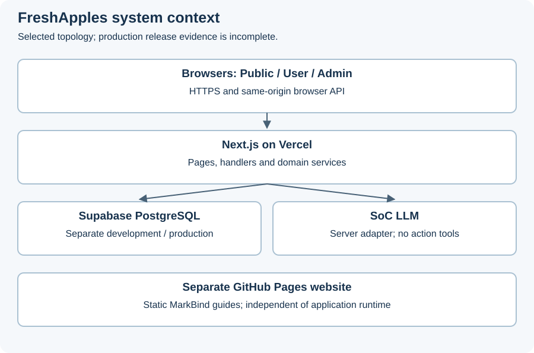
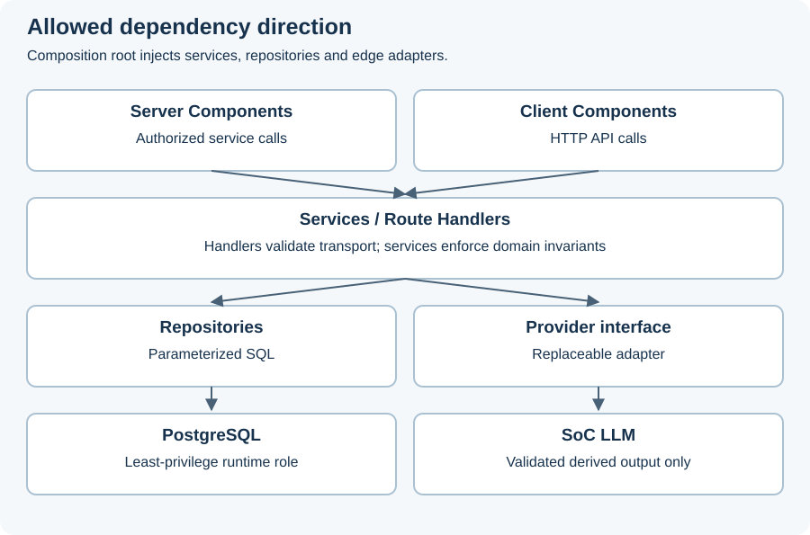
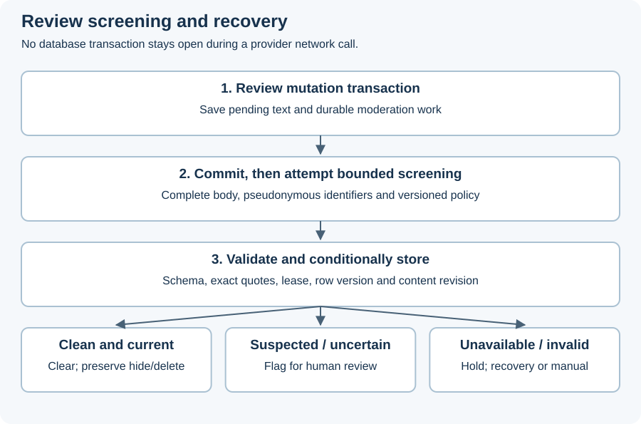
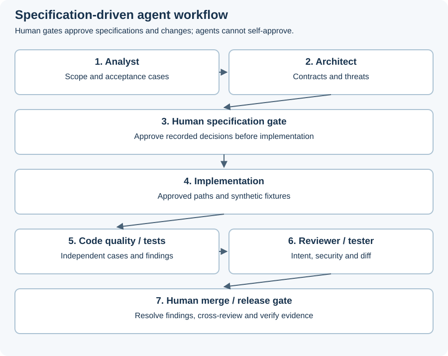

# Developer Guide

FreshApples is a text-only movie-review community with public discovery, authenticated User contributions and a separate Admin interface. This guide explains the system design, development process and operation. The authoritative behaviour is recorded in the [specifications](https://github.com/CS3227-2610-MP3-FreshApples/CS3227-2610-MP3/tree/master/spec).

**Status: incomplete project, inspected 22 October 2026.** Implementation descriptions mean code exists in the inspected checkout, not that release acceptance has passed. Test files are not passing results. Production deployment, complete journeys, live-model evaluation and operational evidence remain incomplete.

## 1. Architecture



FreshApples is one modular Next.js application. React pages and Node.js Route Handlers share domain services, PostgreSQL and AI execution infrastructure. There is no separate Express backend, persistent worker, message broker, Supabase Auth or browser-side LLM client. GitHub Pages serves the MarkBind product website independently.

| Technology | Repository version and purpose |
| --- | --- |
| Next.js / React | 16.4.0 / 19.3.0; App Router, frontend and backend |
| TypeScript | 5.9.3; shared types and service contracts |
| PostgreSQL / pg | PostgreSQL 17 in local tests; pg 8.23.1 for server-only SQL |
| Zod / Argon2 | Zod 4.6.7 validation; @node-rs/argon2 2.2.2 password hashing |
| Vitest / Playwright | 4.1.11 / 1.64.0; unit, integration and browser tests |
| MarkBind | 7.2.1; documentation website |

Versions and lockfiles are committed separately for the root application and `docs/`. Application CI uses Node.js 24; documentation publishing uses Node.js 22. Before changing Next.js code, read the relevant local guide in `node_modules/next/dist/docs/`, because older Next.js conventions may not apply.

### 1.1 Layers and dependencies



| Location | Responsibility |
| --- | --- |
| `src/app/` | Public pages, User pages under `/app`, Admin pages under `/admin`, `/api/v1` Route Handlers |
| `src/components/` | Reusable UI; Client Components call HTTP APIs |
| `src/server/http/` | Transport validation, errors, request IDs, pagination and conditional writes |
| `src/server/services/` | Authorization, domain invariants, transactions and orchestration |
| `src/server/repositories/` | Parameterized SQL and persistence interfaces |
| `src/server/adapters/soc-llm/` | Replaceable provider and deterministic fakes |
| `src/server/db/` | Pool, transaction helper and SQL migrations |
| `src/server/config/` | Core and AI configuration validation |
| `src/server/composition.ts` | Per-instance pool and service graph; the recorded D-23 shared-instance exception |
| `spec/`, `workflow/`, `logs/` | Behaviour/decisions; plans/roles/handoffs; interaction summaries |

UI cannot access SQL or the provider directly. Handlers validate transport input and call services, which enforce roles, ownership and active-account status. Server Components may call authorized services directly using the same safe DTO projections as HTTP endpoints. Server-only modules keep credentials out of browser bundles and props.

### 1.2 Ownership and transactions

Identity owns accounts, sessions and account-status transitions. Catalogue owns movie metadata and summary-change markers. Reviews owns content, clearance, visibility and aggregates. Moderation coordinates reports and human decisions through explicit Review and Identity interfaces. Announcements owns draft/public content. AI owns derived results, durable work, executions and quotas. Audit records administrative mutations.

Cross-module writes that must agree use one transaction. Follow the recorded lock order: Account, Movie, Review, Report; lock multiple Reviews in ascending ID order. Do not duplicate another module's status or visibility logic. An audit insertion failure rolls back its administrative mutation. Never hold a database transaction open during an LLM network call.

## 2. Data and HTTP contracts

### 2.1 Persistence

The initial schema is `src/server/db/migrations/1791896395207_initial-schema.sql`. Full fields, constraints, indexes, privileges and retention rules are in `spec/data-model.md`.

| Entity group | Relationship and purpose |
| --- | --- |
| Account, Session | Accounts have sessions; only session token hashes are stored |
| Movie, Review | Reviews reference Movie and author; content revision differs from mutable row version |
| Report and evidence | Reports retain snapshots; reporter projections exclude received-report information |
| ReviewSummary, ReviewModeration | Validated derived content and source/model/prompt provenance |
| ModerationWork, AIJob | Durable recovery work and execution history |
| SchedulerLease, AIBudgetDay, AIBudgetReservation, RateLimitWindow | Cross-instance leases, budget reservations and throttling |
| Announcement, AuditEntry | Draft/public content and minimal administrative history |

Use opaque UUIDs, UTC timestamps and integer versions. Author deletion and Admin hiding are separate retained states. Pending/flagged Reviews never enter public text, rating aggregates or summaries. Archived Movies are not public. Eligible-review changes advance `Movie.reviews_revision`, immediately invalidating old summaries.

All application tables live in schema `app`. Runtime uses least-privilege `app_runtime` via Supabase's transaction pooler, normally port 6543, with CA-verified TLS and initially one connection per instance. Parameterize SQL; do not use named prepared statements. Migrations use direct/session connections. Keep `app` outside Supabase Data APIs and revoke API-role access. Exposing a table requires deny-by-default RLS and direct-access tests first.

### 2.2 API conventions

The canonical endpoint inventory and error shapes are in `spec/api.md`. APIs use JSON under `/api/v1`, strict mutation-field validation, a 32 KiB body limit, safe error envelopes and request IDs. Private/changing data uses `Cache-Control: no-store`. Lists have stable ordering with ID tie-breakers; default page size is 20 and maximum 100.

Protected browser writes require an active authorized session, exact Origin matching and `X-CSRF-Token` from `GET /api/v1/auth/csrf`. Conditional writes use the quoted current version in `If-Match`; missing preconditions return 428 and stale versions return 409. Preserve entered form text after recoverable errors.

### 2.3 Admin Review API (A-04)

Active Admin sessions can read `/api/v1/admin/reviews` and `/api/v1/admin/reviews/:id`. The list defaults to all Reviews, including retained hidden/deleted rows, with `page`, `pageSize`, optional `movieId`/`assessment` filters and `updated_at DESC, id ASC` ordering. Historical assessments carry their content revision and do not describe newly edited text.

POST `approve`, `hide` or `restore` beneath `/api/v1/admin/reviews/:id` with JSON `reason` (10–1,000 trimmed Unicode code points), quoted current `If-Match` and normal session-bound CSRF/Origin protection. Success returns state and ETag. Repeated transitions return 200 with unchanged version and an audited `no_op`; a stale version returns 409 even for redundant transitions.

Moderation coordinates Review transitions, work updates and audit in one transaction. Approval preserves deletion and hiding; restore clears only the Admin hidden flag. Pending, undeleted restored Reviews remain unpublished while current cancelled work is reactivated with attempt history preserved. Recovery screens later. These routes work with AI disabled, never call the provider and never add strikes. Archived Movies remain non-public.

### 2.4 Core lifecycle examples

**Editing a published Review.** The service checks owning active User, fields and current version, then locks the affected records. A body edit advances content revision, resets clearance, removes old public eligibility, updates aggregates and invalidates the Movie summary in the same transaction as durable work. After commit, screening attempts the current text. Rating-only edits retain existing clearance and cannot clear held text.

**Human approval racing AI completion.** Approval requires Admin role/status, Origin/CSRF, a reason and current version. It updates Review state, work/summary eligibility and audit atomically. The in-flight AI result fails its captured version/lease guards and cannot override the human action. Approval still preserves author deletion and Admin hiding.

**Archiving and restoring a Movie.** Archive retains Reviews/history while changing public eligibility and invalidating summaries. Public reads return 404. Restore preserves Review moderation states and never publishes unchecked content; it marks the Movie for a scheduled summary update. Existing durable screening work can be considered by later recovery once the Movie is active; Movie restore does not itself reactivate cancelled Review work. This is a coordinated domain transition, not row deletion.

**Reporting another Review.** Submission validates category/explanation, rejects self-reporting and duplicate open reports, and stores an evidence snapshot. The reporter reads only their submitted receipts/history. Later edits/deletion do not rewrite evidence. Received-report counts, reporter identity, private reasons and strike history never enter target-facing projections. **Incomplete:** the separate Admin decision/strike workflow is unfinished in this checkout.

### 2.5 Safe errors and client recovery

Errors have `{ error: { code, message, fieldErrors?, requestId } }`. Responses carry a server-generated `X-Request-Id`; incoming request IDs are not trusted. Never return stack traces or raw database/provider errors.

| Status | Meaning | Client action |
| --- | --- | --- |
| 400 | Malformed request/header | Correct request structure |
| 401 | No valid session | Sign in before protected work |
| 403 | Forbidden or failed CSRF | Check role/status and token/origin binding |
| 404 | Missing or ownership-protected object | Do not infer private resource existence |
| 409 | Conflict/stale version | Reload and reconcile user intent |
| 413 / 415 | Oversized / unsupported body | Reduce payload / use supported JSON |
| 422 | Field validation | Show safe field errors; preserve input |
| 428 | Missing If-Match | Fetch current version before writing |
| 429 | Rate limit | Honour Retry-After; avoid retry flooding |
| 500 / 503 | Unexpected fault / unavailable dependency | Keep input and use request ID for investigation |

Review writes can await the 75-second AI deadline, an explicit exception to ordinary write latency. Clients allow longer and recover via own-review reads after interruption rather than blindly resubmitting. A saved pending Review is a successful save even when screening cannot run.

## 3. Runtime AI

Both features use SoC LLM through a server-only adapter. No other runtime model fallback is authorized. Public readers benefit from the User-facing summary; Admins use screening assessments to find content needing human attention. Neither interface provides an AI generate/retry button.

### 3.1 Public review summaries (FR-08, AI-01)

The secret-authenticated daily sweep selects active Movies with pending eligible-review changes, skips unchanged content and requires at least three eligible Reviews. Input preparation samples uniformly without replacement up to 20 Reviews, persists the seed and selected versions, labels sources `R1`, `R2`, etc., and caps each body at 1,000 characters. Deterministic reduction keeps instructions/input within the 8,000-token estimate. Fewer than three fitting Reviews fails safely.

Output contains bounded overall text, strengths, criticisms and mixed opinions. Validation rejects unknown fields, excessive lengths and citations outside the sample. Publication rechecks Movie visibility, source revision and execution lease, then stores output and clears pending work atomically. Concurrent edits, deletion, hiding or archive prevent stale publication. Unchanged valid summaries do not expire merely because a day passes.

GET `/api/v1/movies/:id/summary` reads stored output without a provider call. The UI shows generation time, included/eligible counts, truncation information and “AI summary of a sample; may miss opinions or make mistakes”. Missing/stale output shows awaiting scheduled update; fewer than three eligible Reviews shows insufficient reviews.

Implementation: `src/server/services/ai/summary/`, `src/server/repositories/summary/`, the public summary GET and `/api/v1/internal/cron/summaries`. **Incomplete:** controlled live-model evaluation, full User browser journey and deployed scheduling/capacity evidence.

### 3.2 Automatic profanity screening (FR-09, AI-02)



Every new Review, resubmission or body edit saves pending text and durable work atomically. After commit, the same handler attempts and awaits bounded screening. Rating-only edits retain clearance. Input includes complete body (maximum 2,000 characters), pseudonymous Review/content revision identifiers and versioned policy. Reports, email, profile, sessions and ratings are excluded. Oversized input goes to manual review rather than screening a fragment.

The reviewed English policy is `profanity-policy-v1` in `src/server/services/ai/moderation/policy/`. Output requires a valid assessment, bounded explanation, exact-substring matches and limitations. Suspected profanity requires a match; a clean result requires none. Fixed server logic maps `no_profanity_detected` to cleared and suspected/uncertain to flagged. Invalid output goes to manual review. AI flags never create Reports/strikes, hide Reviews, change accounts or override human decisions.

Completion checks the lease, captured row version and content revision. Concurrent edits or human actions make obsolete output stale. Outage, disabled AI or quota contention leaves text saved and unpublished. Recovery cron attempts due work; three failed executions exhaust automatic retries for a revision. Capacity deferrals do not consume attempts. Admins resolve held content through authorized, reasoned, version-checked actions.

Implementation: `src/server/services/ai/moderation/`, Review mutations, `/api/v1/internal/cron/review-moderation` and Admin review queue. **Incomplete:** controlled live-provider acceptance, consolidated adversarial quality evaluation and deployed outage-backlog validation.

### 3.3 Shared execution controls (AI-03)

PostgreSQL coordinates one active execution per environment and deduplicates subject/revision/model/prompt/policy combinations as applicable. Cost is reserved before dispatch and reconciled afterward; unknown usage is charged conservatively at the reservation. Token estimates use UTF-8 byte length, not a tokenizer. Requests-per-minute limits and daily budgets are shared across instances.

Limits are 30 seconds per attempt, at most two attempts per execution and a 75-second execution deadline. AI/review routes declare a 120-second function limit; deployed duration and Fluid compute require operator verification. No detached continuation runs after response.

Initially each daily sweep attempts at most one Movie or Review. Leases, pending markers and backoff support recovery but do not establish a freshness guarantee. Measure held-work age/count and summary backlog before release. Environment allocations and model prices follow `spec/deployment.md` and verified provider configuration; historical values are not live guarantees.

## 4. Security and testing

### 4.1 Runtime boundaries

| Threat | Control | Tests/evidence to inspect |
| --- | --- | --- |
| Role/ownership bypass | Identity/service guards, active-status recheck, reporter-only projections | `tests/integration/api/auth/`, report and Admin authorization tests |
| Session theft / CSRF | Argon2id, opaque hashed sessions, hosted HttpOnly/Secure/SameSite cookies, bound token and exact Origin | Auth journey, CSRF and throttling tests |
| SQL injection / stored XSS | Parameterized SQL, strict validation, escaped plain text | Input/schema tests and malicious-content rendering checks |
| Prompt injection / exfiltration | Minimal bounded context, versioned prompts, no model action tools or credentials | `tests/unit/ai/moderation/adversarial-screening.test.ts`, summary input/output suites |
| Fabricated or stale output | Schema, source-ID and exact-quote validation; lease/version/revision guards | Summary output edge/publication concurrency tests; moderation dispatcher tests |
| Flooding / outage | Shared throttles, budget reservations, bounded concurrency/deadlines/retries | Runtime, scheduler, work-queue and recovery integration tests |
| Secret leakage | Server-only config, safe errors, redacted logs, no raw prompts by default | Gitleaks commit/assets and random bundle-canary checks |

Prompt delimiters alone do not prevent injection. Containment depends on no model action tools, validation, authorization and guarded writes. Schema-valid text can still be inaccurate and requires human quality evaluation. Free text can contain personal data; replacing identifiers does not establish anonymity.

Only human Admin acceptance can produce report-based strikes. Acceptance, distinct-incident accounting, threshold suspension and session revocation must be atomic. **Incomplete:** Admin Report-decision and user-management endpoints/journeys are absent from this inspected checkout; shared account-status primitives alone do not complete them.

### 4.2 Development-process security

Repository references, issue text, retrieved content and generated patches are untrusted data, not permission to reveal credentials or expand access. Agents receive bounded paths/actions and isolated synthetic fixtures. No production credentials/data enter prompts, fixtures or public artifacts. Agents cannot approve their own changes or deploy production.

`.github/workflows/ci.yml` defines `lint-typecheck`, `unit`, `integration`, `e2e`, `build-secret-scan` and `dependency-audit`. Application CI uses read-only repository permission and synthetic values, without deployment credentials. It scans commit ranges and built assets, tests random canary-secret absence and checks dependency audit against recorded exceptions. Do not suppress failures just to pass a gate.

**Incomplete:** consolidated development-agent security rehearsal/evaluation (R-03), release-wide authorization/cache-isolation matrix and current green release evidence. Workflow files alone do not prove branch protection is configured.

### 4.3 Commands and release evidence

Run at the repository root unless indicated; use synthetic fixtures only.

| Check | Command / preparation |
| --- | --- |
| Lint | `npm run lint` |
| Fresh-checkout type-check | `npx next typegen`, then `npx tsc --noEmit` |
| Unit | `npm run test:unit` (no database) |
| PostgreSQL/API integration | Set loopback `TEST_DATABASE_URL` in shell; `npm run test:integration` |
| Production build | `npm run build` |
| E2E | Build first; `npx playwright install chromium`; with loopback `TEST_DATABASE_URL`, `npm run test:e2e` |
| Secret scan | Build first; gitleaks on PATH; `npm run check:secrets` scans `origin/master..HEAD` and `.next/static` |
| Dependency audit | `node scripts/check-audit.mjs` |
| Documentation | In `docs/`: `npm ci`, `npm run build`; `npm run serve` for preview |

Integration refuses non-loopback hosts, creates a throwaway migrated database and synthetic roles, truncates tables between files and drops the database afterward. Its test-only server login needs database/role creation privileges. E2E creates its own database, runtime login and secrets, serves the built app at `127.0.0.1:3100`, then cleans up. The E2E wrapper does not build.

AI tests live under `tests/unit/ai/`, `tests/integration/ai/` and `tests/integration/api/cron/`. Existing E2E files cover health, Admin catalogue and Admin Reviews; they do not establish the complete User/Admin acceptance matrix.

**Incomplete release checks:** `spec/verification.md` records a proposed release bar of at least 10 benign and 10 adversarial cases per AI feature, all hard security checks passing and at least 90% benign grounding/usefulness under a recorded human rubric. Complete controlled SoC smoke runs for both features, User/Admin success and failure journeys, keyboard/focus/errors/responsive checks, performance/load and backlog measurements, direct Supabase access checks, and deployed isolation/restore/rollback evidence. Fakes prove orchestration, not model quality.

Record each release command, source revision, environment, pass/fail and evidence path. Trace requirement to task, test and result. Explicitly mark failed, skipped, deferred and untested work.

## 5. Local development

### 5.1 Setup

Use Node.js 24, npm and disposable PostgreSQL 17 (Docker or native). Browser tests need the Chromium version expected by the locked Playwright package.

```powershell
npm ci
Copy-Item .env.example .env.local
```

Edit `.env.local` privately; its placeholders are not runnable configuration. Use `APP_ENV=local`, exact `PUBLIC_APP_URL` such as `http://localhost:3000`, local runtime `DATABASE_URL`, distinct high-entropy `SESSION_SECRET`/`RATE_LIMIT_KEY_SECRET` (at least 32 characters), and an environment-specific `CRON_SECRET`. Remove the example CA placeholder for loopback local/test use. Hosted connections require the project's full PEM CA. Do not add `sslmode` URL parameters.

Start with `AI_ENABLED=false`, `AI_PROVIDER=fake`. For deterministic AI, enable it with valid configuration from `.env.example` and `src/server/config/ai.ts`; budget, quota and price fields must still validate. Production rejects fake. Never point local development at production storage.

Core configuration errors fail readiness. Missing/invalid AI configuration disables generation without failing core readiness. Missing cron configuration rejects every cron call. Exact names and rules are in `spec/deployment.md` section 10.3; new variables require placeholders and contract updates.

### 5.2 Database roles and migrations

Start the recorded local server with a private local password substituted outside evidence/logs:

```text
docker run --rm --name mp3-postgres -e POSTGRES_PASSWORD=<local-password> -p 127.0.0.1:5432:5432 -d postgres:17
```

Tests provision their own synthetic roles/databases. A manually managed local database also requires `app_runtime`, `anon` and `authenticated` before the first migration; provision local-only roles with the operator connection. Runtime does not need test database-creation privileges.

For each Supabase project, an operator connects through the owner/direct connection and creates:

```sql
CREATE ROLE app_runtime LOGIN NOSUPERUSER NOCREATEDB NOCREATEROLE NOREPLICATION NOBYPASSRLS;
```

Set its password interactively with `\password app_runtime` in `psql`. Never put the password in SQL statements, shell commands, the SQL editor or logs. Store the runtime pooler URL only in that environment's server settings. Supabase supplies `anon` and `authenticated`. Missing required roles cause the initial migration to fail/roll back; it revokes API-role/`PUBLIC` access and grants specified runtime privileges.

Set operator `MIGRATION_DATABASE_URL` (direct/session) and hosted `DATABASE_CA_CERT` in the shell; run `npm run db:migrate`. Shell scripts need shell environment variables; do not assume `.env.local` is loaded by every command. Runtime uses its separate least-privilege connection.

Never edit shipped migrations; add compatible migrations and test them on disposable data. Hosted migration is an operator release step requiring pre-migration backup and restore plan. The initial migration has no down section: recovery uses the backup, not an invented destructive rollback.

### 5.3 Run and troubleshoot

```powershell
npm run dev
```

Open `http://localhost:3000`. Public `/api/v1/health/live` checks liveness. `/api/v1/health/ready` checks core configuration, database access and the existence of an Admin. A fresh database remains unready until first-Admin provisioning. AI outage alone does not fail readiness. Generic no-store health responses keep sensitive diagnostics in restricted logs.

The secret-only POST `/api/v1/internal/bootstrap/admin` is separate from public registration. Follow D-83 in `spec/deployment.md` and [Release Information]({{baseUrl}}/releases.html): verify exactly one Admin with `npm run db:verify-first-admin`, check readiness, remove the three bootstrap variables through the Vercel control plane, and recheck disabled bootstrap/readiness. The application cannot remove its own deployment variables. **Incomplete:** production bootstrap/removal evidence and tester-account assignment (OQ-06).

### 5.4 First-run walkthrough in PowerShell

Use a terminal at the repository root. The examples below use `npm.cmd` and `npx.cmd` to avoid PowerShell script-shim restrictions. On macOS/Linux use `npm` and `npx`. There is no need to weaken execution policy.

```powershell
Get-Location
node --version
npm.cmd --version
docker --version
npm.cmd ci
```

Run application and documentation servers in separate terminals. Install their dependencies separately: the root installation does not install MarkBind.

For database-backed tests, start Docker Desktop and the loopback-only PostgreSQL container from section 5.2, then check it:

```powershell
docker ps --filter name=mp3-postgres
docker exec mp3-postgres pg_isready -U postgres
```

Database readiness does not mean application tables or an Admin exist. Tests automate their own throwaway databases; an interactive application database needs its own role provisioning and migration. `npm run db:seed` now supplies local/test synthetic Movie fixtures through the Admin API after database, migration and synthetic Admin provisioning; see section 7.1. It does not automate database or account provisioning. Do not use the test server's privileged login as hosted runtime configuration.

For an operator migration, supply the local-only connection in the same shell, replacing placeholders privately:

```powershell
$env:APP_ENV = 'local'
$env:MIGRATION_DATABASE_URL = 'postgresql://postgres:<local-password>@127.0.0.1:5432/<local-app-database>'
npm.cmd run db:migrate
```

Create/select that application database and provision the prerequisite roles first. For hosted migrations use the controlled backup/release procedure instead. After configuring `.env.local`, run:

```powershell
npm.cmd run dev
```

Leave the terminal running. Open the URL printed by Next.js, normally `http://localhost:3000`. It must match `PUBLIC_APP_URL`: switching between `localhost` and `127.0.0.1` changes Origin/cookie behaviour. Ctrl+C stops the server. Restart after changing environment configuration so the composition root re-reads it.

### 5.5 View MarkBind locally

Documentation preview needs no database, application server, SoC key or Vercel account. From the repository root:

```powershell
Set-Location docs
npm.cmd ci
npm.cmd run serve
```

Keep the terminal running and open the local address printed by MarkBind. Its usual port is 8080. The guide is available at the following base-path URL (verified with the local server):

```text
http://localhost:8080/CS3227-2610-MP3/DeveloperGuide.html
```

Use the server's emitted address if it differs, or open its homepage and click **Developer Guide**. Save changes to `DeveloperGuide.md` to rebuild/refresh the preview. Stop with Ctrl+C. Return to the application directory using `Set-Location ..`.

If port 8080 is occupied, inspect the installed options and select another port:

```powershell
# Inside docs/
npx.cmd markbind serve --help
npm.cmd run serve -- --port 8081
```

The corresponding URL uses port 8081. Check the terminal's served base path before changing `site.json`; keep the production base URL intact.

For a production-style build, stop the preview first:

```powershell
# Inside docs/
npm.cmd run build
Test-Path _site/DeveloperGuide.html
Get-ChildItem _site/assets/developer-guide
```

The build should contain the guide HTML and all referenced SVGs. `_site/` is generated and ignored by Git. Edit Markdown/layouts/CSS/assets rather than generated HTML. Preview through HTTP rather than double-clicking the HTML because the site uses base-path URLs.

| Source | Purpose |
| --- | --- |
| `docs/DeveloperGuide.md` | Developer content |
| `docs/site.json` | Page registration, titles, base URL and publishing settings |
| `docs/_markbind/layouts/default.md` | Shared navigation/footer/layout |
| `docs/css/site.css` | Website styling |
| `docs/assets/developer-guide/` | Diagrams |
| `docs/index.md`, `docs/releases.md` | Application links and release state |

For a new page, create Markdown, register it in `site.json` and link it from navigation. Follow existing `{{baseUrl}}/PageName.html` page links and relative image paths. Check desktop and narrow layouts, heading hierarchy, tables, image readability and links.

`serve` and `build` do not publish. Do not run `npm run deploy` merely to preview: publishing writes to the remote website branch and belongs to the authorized team workflow.

### 5.6 Focused test commands

Set a private local password in the loopback test URL in the same terminal that runs tests. Never retain it in evidence:

```powershell
$env:TEST_DATABASE_URL = 'postgresql://postgres:<local-password>@127.0.0.1:5432/postgres'
npm.cmd run test:unit
npm.cmd run test:integration
```

To investigate a specific case, pass a file after `--`, then run the applicable full suite before handoff:

```powershell
npm.cmd run test:unit -- tests/unit/ai/summary/output-schema.test.ts
npm.cmd run test:unit -- tests/unit/ai/moderation/adversarial-screening.test.ts
npm.cmd run test:integration -- tests/integration/api/admin/admin-reviews.test.ts
```

For browser tests, use the test environment used by CI, build, and let the wrapper create its database/login/secrets:

```powershell
$env:APP_ENV = 'test'
$env:PUBLIC_APP_URL = 'http://127.0.0.1:3100'
$env:AI_PROVIDER = 'fake'
$env:AI_ENABLED = 'false'
npm.cmd run build
npx.cmd playwright install chromium
npm.cmd run test:e2e
# Optional focused run, still through the wrapper:
npm.cmd run test:e2e -- tests/e2e/admin-reviews.spec.ts
```

Plain `playwright test` bypasses wrapper setup and is not an equivalent command. Do not point tests at Supabase: remote connections are intentionally rejected. If cleanup fails, identify the exact generated resource and follow repository permission rules before manual deletion.

### 5.7 Explore public APIs

From a second terminal while Next.js runs:

```powershell
Invoke-RestMethod 'http://localhost:3000/api/v1/health/live'
Invoke-RestMethod 'http://localhost:3000/api/v1/health/ready'
Invoke-RestMethod 'http://localhost:3000/api/v1/movies?page=1&pageSize=20&sort=title_asc'
Invoke-RestMethod 'http://localhost:3000/api/v1/announcements?page=1&pageSize=20'
```

A first-run readiness 503 may be correct. Inspect status, `X-Request-Id`, cache headers and JSON in the browser Network panel. A valid Movie UUID also exposes public detail, `/reviews` and `/summary` reads. Summary reads must not dispatch AI.

For authenticated writes, use the UI or integration fixtures. A client must preserve cookies, obtain a CSRF token, send the exact Origin and obtain a fresh token after login changes the binding. Versioned writes also need the current quoted ETag in `If-Match`. Do not disable protections to simplify local testing.

### 5.8 Troubleshooting

| Symptom | What to check |
| --- | --- |
| PowerShell blocks npm.ps1 | Use `npm.cmd`/`npx.cmd`; no policy change needed |
| MarkBind missing | Run `npm.cmd ci` in `docs/`, then the local npm script |
| npm install stalls | Check reported registry/network error; retain lockfiles and do not silently upgrade |
| MarkBind 404 or missing assets | Check server-emitted URL/base path, site config and image paths |
| Port already occupied | Identify the owner; stop only your own service or choose supported preview port |
| Live 200 but ready 503 | Check core config, connection/CA, migrations, roles and Admin existence |
| Hosted TLS failure | Use correct project CA and endpoint; never disable verification |
| Migration missing role | Provision required roles as operator; do not edit shipped migration |
| Integration rejects URL | Use loopback disposable PostgreSQL; remote denial is deliberate |
| E2E fails to start | Build first, install locked Chromium and free port 3100 |
| Browser write 403 | Check session role/status, exact Origin and current CSRF binding |
| Write 428/409 | Fetch current ETag, reconcile intent and retry with current quoted version |
| Review saved but not public | Check pending/flagged, hidden/deleted and archived states |
| AI remains pending | Check config, reviewed policy, quota/lease contention and durable work/backoff |
| Summary absent after changes | Old revision invalidates immediately; scheduled refresh is bounded |
| Missing generated route types | Run `npx.cmd next typegen`, then `npx.cmd tsc --noEmit` |

## 6. Specification-driven and multi-agent development



Authority order is human-approved specifications/decisions, `spec/README.md` and its referenced contracts, existing code on `master`, then repository working instructions. Conflicts or missing behaviour/design decisions stop affected work for a human decision. Update `spec/` before code, tests and guides. Copy recorded requirement IDs; never manufacture plausible IDs.

The analyst supplies scope and Given/When/Then examples. The architect checks boundaries, contracts, transactions and threats. A human approves specifications before implementation. Implementation stays in assigned paths. A separate code-quality/test-generation agent checks readability and independent cases; a separate reviewer checks intent, negative paths, security and the diff without adopting implementation assumptions. A human resolves findings and approves merge; both developers review release evidence.

This generator/verifier workflow has a human orchestrator. Role definitions live in `workflow/agents/` and `.codex/agents/`. Plans and frozen contracts are in `workflow/PLAN.md`, `workflow/COMMIT-PLAN.md` and `workflow/contracts.md`. Use isolated writable workspaces/databases; do not concurrently edit the same files. The plan requires escalation after two unsuccessful verify/fix rounds.

Handoffs record task/requirement IDs, revision, allowed paths/actions, files, rationale, results, gaps and receiver/next action. Examples include `workflow/handoffs/A-03/`, `A-04/` and `U-04a/`. These demonstrate particular sessions, not universal completion. Each file-changing chat has one `logs/` summary, labelled awaiting human verification until reviewed.

Developer A is Lim-ZY (User features, Identity/public API and security); Developer B is thegrimbee (Admin, database, deployment/CI, infrastructure and developer guide). D-85 assigns public summaries to B. Shared changes require cross-review.

Use `feat/`, `fix/` or `chore/` branches, scoped Conventional Commits and reviewed PRs to `master`. Agents leave changes in the working tree unless explicitly instructed to commit, push or open a PR; each requires separate authorization. No project file deletion without explicit permission.

**Incomplete:** R-03 consolidated agent evaluation, human reconciliation of stale planning statuses, final traceability and verification of outstanding interaction summaries. Some plan rows lag behind implementation; this guide does not silently change their approval state.

### 6.1 Walkthrough for a scoped change

1. Read `AGENTS.md`, relevant specifications and decisions, then inspect code/tests. Identify existing requirement IDs and permitted paths.
2. For behaviour/interface changes, obtain analyst examples, architect boundary/threat review and a human-recorded decision before implementation. Documentation changes alone do not authorize product changes.
3. Implement approved scope through module interfaces. Keep vendor types at adapters; avoid shared mutable state, control flags and whole records where an ID suffices.
4. Add meaningful tests at the right levels. Mocked SQL cannot establish transaction/locking correctness; use PostgreSQL for rollback/race cases.
5. Run scoped checks and applicable full checks. Independent quality/reviewer roles assess the pinned revision/diff and return evidence.
6. Update guide/release notes and one session summary. Label proposals, unresolved findings and skipped checks accurately.
7. Leave a reproducible handoff for human review. Commit, push, PR creation, merge and deployment each remain separately authorized.

A useful handoff includes revision, command/environment, result and evidence path, not merely “tests pass”. Do not include environment dumps or production rows. `logs/TEMPLATE.md` defines the session-summary format and human-verification checklist.

## 7. Deployment and isolation

| Environment | Application/data | Isolation |
| --- | --- | --- |
| Local/test | Next.js, disposable PostgreSQL 17, fake provider | Loopback DB, synthetic fixtures and per-run secrets |
| Shared development | Trusted Vercel Preview, development Supabase project | Development credentials, synthetic data and allocated AI budget |
| Production | Reviewed `master` on Vercel Production, separate Supabase project | Production-only credentials, CA, cron/session secrets and AI budget |
| Website | Static MarkBind on GitHub Pages | No runtime database/provider credentials |

Vercel Git integration is the recorded application deployment mechanism; Actions supplies required checks. Scope Preview/Production variables separately. The development database is shared intentionally; do not create a Supabase branch per preview or use production credentials. Fixed AI allocations must fit shared quotas. No production data enters development fixtures or prompts.

**Incomplete production release:** [Release Information]({{baseUrl}}/releases.html) records no published app release; live Vercel URL remains to be recorded. Historical reachability/hosting smoke tests do not establish current deployment acceptance. The merged checkout includes root `vercel.json` cron configuration; hosted activation and verification remain incomplete (see section 7.1). The following is the approved plan, not an execution record:

1. Confirm reviewed revision, required green checks, hosting eligibility and isolated configuration.
2. Verify a private backup; apply compatible migrations as the operator.
3. Deploy through team-managed Vercel integration, verify duration/Fluid compute and health, and complete first-Admin provisioning/removal if needed.
4. Configure daily secret-authenticated summary/moderation crons (recorded examples `0 0 * * *` and `0 1 * * *`, UTC). Test invalid secrets, duplicate runs, recovery and backlog. Preview tests invoke handlers explicitly.
5. Verify Preview cannot read production data, direct Supabase denial, browser secret absence and private-cache isolation.
6. Record URLs, revision, operator, commands, UTC times, outcomes and redacted evidence; complete restore/rollback and paused-project recovery rehearsals.

Daily encrypted off-site exports and pre-migration backups are required. Private destination, automation and tested restoration are **incomplete**. Proposed RPO 24 hours/RTO 4 hours are team targets, not Supabase Free guarantees. Rollback must account for database compatibility and pre-migration backups. Free tiers can pause; no always-on SLA is promised.

### 7.1 Release setup and operator runbook (B#11 / R-04)

Application code runs on Vercel; PostgreSQL runs on Supabase. GitHub Pages hosts only the product information site. The configuration contract is [spec/deployment.md](https://github.com/CS3227-2610-MP3-FreshApples/CS3227-2610-MP3/blob/master/spec/deployment.md). No hosted setup, backup upload, production migration or deployment is performed by this runbook's implementation. Record actual release evidence before declaring R-04 complete.

#### Manual Vercel configuration

1. Use separate Preview/development and Production/Supabase projects and credentials. Set the Vercel production branch to `master`; retain required GitHub checks and human PR review. Verify the existing Hobby eligibility decision still applies to the actual repository and deployment owner.
2. Add variables from `.env.example` to the appropriate Vercel environment. `PUBLIC_APP_URL` is the exact browser origin, for example `https://your-app.vercel.app`, without trailing slash, path, query or fragment. It is server configuration despite its name; do not rename it to `NEXT_PUBLIC_APP_URL`. A mismatched origin causes CSRF failures. For Preview, use one stable trusted branch domain with its matching origin; arbitrary preview URLs do not automatically match it.
3. Set `APP_ENV=production` in Production and `development` in Preview. Set `DATABASE_URL` to the environment's least-privilege transaction-pooler connection (usually port 6543) and `DATABASE_CA_CERT` to the full project PEM CA. Remove `sslmode`/other `ssl*` URL parameters; the driver configures CA-verified TLS explicitly.
4. Set independent high-entropy `SESSION_SECRET`, `RATE_LIMIT_KEY_SECRET` and `CRON_SECRET` (at least 32 characters), distinct across environments; session and rate-limit secrets must differ. Retain the `.env.example` session TTL and moderation threshold unless the recorded policy changes. Do not add migration, backup or restore credentials to Vercel runtime.
5. Start with `AI_ENABLED=false`. For live AI, set `AI_PROVIDER=soc_llm`, `SOC_LLM_BASE_URL`, API key, model, verified prices and all required AI limits from `.env.example`/the deployment contract. Production must never use `fake`. Verify the current model and prices before enabling AI; development/production quotas must fit the shared allocation. The recorded partitions are 30/60 RPM and 26,666,666/53,333,333 microdollars daily respectively. Keep the initial one-item sweeps and bounded timeouts.
6. Enable Fluid compute and verify the deployed AI cron and review mutation Functions show a 120-second maximum duration. The existing Route Handler exports control this setting; no `MAX_DURATION` environment variable is required.
7. After environment changes, build a fresh deployment in that environment. Environment removal alone does not remove values already captured by an existing deployment. Never promote a Preview build containing development configuration to Production.

The committed `vercel.json` registers summaries at `0 0 * * *` UTC (about 08:00 SGT) and review moderation at `0 1 * * *` UTC (about 09:00 SGT). Verify both under the Production project's Cron Jobs after release. Vercel calls these GET routes on Production and supplies `Authorization: Bearer <CRON_SECRET>` when that variable is configured. Hobby timing can vary within the scheduled hour. Preview tests require manual requests with development secrets. See [Vercel cron management](https://vercel.com/docs/cron-jobs/manage-cron-jobs), [cron quickstart](https://vercel.com/docs/cron-jobs/quickstart) and [Fluid compute](https://vercel.com/docs/fluid-compute) (checked 22 October 2026).

#### Manual Supabase configuration and first Admin

Create separate development and production projects. Download each project's CA certificate and copy its direct/session connection for operator use and transaction-pooler connection for runtime. Create `app_runtime` as described below before applying migrations. Keep schema `app` unexposed to Supabase Data APIs; do not enable it as an exposed schema without the specified deny-by-default RLS and tests. No Supabase Auth setup, publishable key or service-role API key is needed.

Load operator secrets from an interactive prompt or private secret manager into process environment, never command arguments or shell history. Node operator scripts do not automatically load `.env.local`. `MIGRATION_DATABASE_URL` uses a privileged direct or session connection, with `DATABASE_CA_CERT` from the same project. TLS may be omitted only for local/test loopback databases. Run migrations before merging code that needs them, maintaining compatibility with the currently deployed version.

For the first Admin, temporarily configure `ADMIN_BOOTSTRAP_SECRET`, `ADMIN_BOOTSTRAP_EMAIL` and `ADMIN_BOOTSTRAP_PASSWORD` in the intended environment, deploy, and invoke `POST /api/v1/internal/bootstrap/admin` with `x-admin-bootstrap-secret` from a private operator session. Never print or save those values as evidence. Then verify `/api/v1/health/ready` is 200 and run `npm run db:verify-first-admin` with the operator connection. It must exit zero with `admin_count=1`. Remove all three bootstrap variables, deploy again, and verify readiness remains 200 and the bootstrap endpoint rejects invocation. Follow the full D-83 procedure in `spec/deployment.md`; do not proceed after a failed verification.

Tester identities/access remain a human assignment under OQ-06. Do not distribute the production Admin credentials as tester access.

#### Encrypted backups and guarded migrations

Install PostgreSQL client tools compatible with the source server (`pg_dump`, `pg_restore`, `psql`) on the operator machine and put them on `PATH`. Use PostgreSQL 17 for the prescribed local rehearsal. The database application archive includes schema `app`, data, migration bookkeeping and grants; it excludes cluster login roles, Supabase-managed schemas, Storage objects, Vercel settings and secrets. Preserve role provisioning and environment configuration separately in private operator records.

The CI integration job installs PostgreSQL 17 clients from PostgreSQL's signed apt repository so archive tests use tools compatible with its PostgreSQL 17 service. That Ubuntu installation step must be confirmed by the first PR CI run.

Set `BACKUP_ENCRYPTION_PASSPHRASE` to an independent high-entropy value of at least 32 characters, stored separately from backups. Set `BACKUP_OUTPUT_PATH` to a unique absolute path outside the checkout on private storage. Existing output files are refused. With the operator database variables set, run:

```text
npm run db:backup
```

The script streams a PostgreSQL custom archive into authenticated AES-256-GCM encryption using a scrypt-derived key. No plaintext archive is written. Only a zero exit status indicates success. Treat failed/partial outputs as unusable; never feed them to a release or overwrite them. Do not place archives in Git, public CI artifacts, the website or a shared public folder. Windows operators must additionally restrict the destination folder ACL to the authorized backup operators; POSIX mode bits alone do not establish Windows ACL privacy.

For a release with pending migrations, set a fresh backup path and run the guarded command:

```text
npm run db:release
```

This takes a backup first and calls the existing migration runner only after a successful export. `npm run db:migrate` remains the low-level operator command for already backed-up release steps and test setup. Never run it as a Vercel build/start hook. Do not record raw migration errors or connection strings as release evidence.

The deployment owner must select private off-site storage, verify its allowance/access controls, copy each successful encrypted export there, and configure an authenticated daily operator scheduler plus alerts for missed/failed exports. Keep the passphrase in a separate recovery location. Verify an uploaded export can be downloaded and restored before enabling the daily schedule. The Vercel application crons do not perform backups. No storage provider, upload automation, retention guarantee or daily backup operation has been configured by this change. RPO 24 hours and RTO 4 hours are team targets requiring rehearsal evidence; Supabase Free does not guarantee them. See [Supabase backups](https://supabase.com/docs/guides/platform/backups) (checked 22 October 2026).

#### Isolated restore and rollback

Use a trusted export, since PostgreSQL archives can contain executable database definitions. Provision a new disposable PostgreSQL 17 database on loopback and the D-31 roles (`app_runtime`, `anon`, `authenticated`) first; do not migrate it or create any user relations. Restrict the operator's temporary directory ACL on Windows. Set `APP_ENV=test`, point `MIGRATION_DATABASE_URL` at that empty database, set `BACKUP_INPUT_PATH` to the encrypted archive and supply the original passphrase. Set `RESTORE_CONFIRM_EMPTY_DATABASE=I_CONFIRM_THIS_DISPOSABLE_DATABASE_IS_EMPTY`, then run:

```text
npm run db:restore
```

The tool authenticates the complete encrypted snapshot before passing any plaintext to `pg_restore`, refuses hosted/nonempty targets, and restores in one transaction with error-stop, preserving grants without restoring original object ownership. It never drops or cleans a schema. Verify migration history in `app.pgmigrations`, expected synthetic counts, constraints, runtime role permissions and app health against the restored database. Record duration and results. Privileged restore success alone does not establish least-privilege runtime health. A restored production export is still private production data: use an isolated operator machine, never development fixtures, prompts or ordinary test suites.

For code rollback, stop the release, select the previous compatible Production deployment in Vercel and smoke-check it with Production configuration. Database changes are not undone by a Vercel rollback. Do not edit shipped migrations or attempt automatic down migrations. If database recovery is required, pause writes, take an incident export, restore the chosen backup in isolation, assess post-backup data loss and have both developers approve a separate hosted recovery/cutover plan. The local restore command deliberately cannot perform that hosted cutover. Recheck runtime privileges, first Admin, readiness and business flows before reopening writes.

#### Synthetic local demonstration data

`npm run db:seed` uses the existing authenticated Admin API and CSRF flow, calling the owning composition services. It creates three fictitious Movies in a local/test loopback app; it never inserts database rows directly, bootstraps accounts or uses production credentials. Provision a synthetic Admin first, then supply the seed settings documented in `.env.example` through private process environment. Use a disposable demonstration database; no concurrent-run or atomic rerun guarantee is provided. Shared development peer-tester access is a separate human action.

#### Release evidence checklist

Record source revision, environment, UTC time, deployment owner and URL, commands/exit status, checks and redacted evidence path. Both developers review the release record. Required evidence includes successful private off-site export/download/isolated restore, runtime grants and migration history, code rollback rehearsal, fresh environment-scoped builds, health live/ready, first-Admin cleanup, browser User/Admin flows, and cron missing/invalid-secret rejection, authenticated execution, overlap/missed-run handling and backlog monitoring. Review pending/manual-review queues and usage/pause warnings before demonstrations. Never include payloads, account details, secret values or raw provider/driver errors.

### 7.2 Product website and diagrams

[FreshApples on GitHub Pages](https://CS3227-2610-MP3-FreshApples.github.io/CS3227-2610-MP3) is separate from the Next.js app. Source is `docs/`; `docs/site.json` defines pages/base URL. `.github/workflows/deploy-markbind.yml` publishes to `gh-pages` after a `master` push or manual invocation.

Diagrams are local SVG files in `docs/assets/developer-guide/`, embedded as ordinary Markdown images. They require no Mermaid runtime, remote renderer or diagram plugin. Keep adjacent text explanations and check the built page at narrow widths.

## 8. Completion and maintenance checklist

| Area | Remaining work |
| --- | --- |
| Catalogue, Identity, Reviews, report submission/history, announcements, AI pipelines, Admin review queue | Implementation exists; verify current acceptance evidence |
| Admin Report decisions/strikes/threshold suspension and user management | Incomplete feature integration and browser/API coverage |
| Live AI/security evaluation | Incomplete controlled provider runs and consolidated human rubric |
| E2E and accessibility | Incomplete complete User/Admin journeys, failure UI and manual evidence |
| Deployment and operations | Incomplete application URLs, isolation, crons, capacity, restore/rollback evidence |
| Workflow/submission | Incomplete verified logs, final traceability, reflections and cross-review |
| Optional watchlist | Not scheduled; requires a recorded human scope decision |

Replace incomplete markers only with traceable implementation and verification evidence. Keep specifications, release information and this guide consistent; send conflicting approval/status records to a human.

## 9. References and acknowledgements

This guide derives from `spec/`, `AGENTS.md`, `workflow/` and the inspected implementation. Dependencies are attributed through the root/docs manifests and lockfiles. SoC LLM provides runtime inference; Next.js/Vercel, PostgreSQL/Supabase and MarkBind/GitHub Pages provide application, storage and website infrastructure. Canonical specifications retain platform/provider references and verification dates.

AI assistance is disclosed in role handoffs and session summaries. This guide and its original SVG diagrams are AI-assisted; its documentation handoff records validation and pending human review. **Incomplete:** final human verification and consolidated project-wide acknowledgement/disclosure review.
